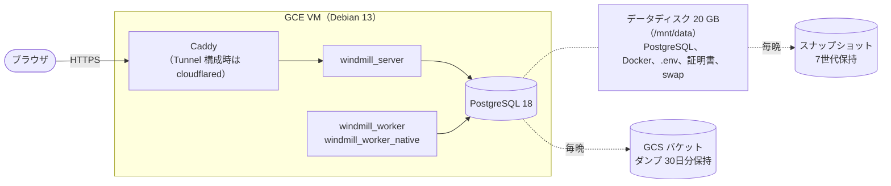
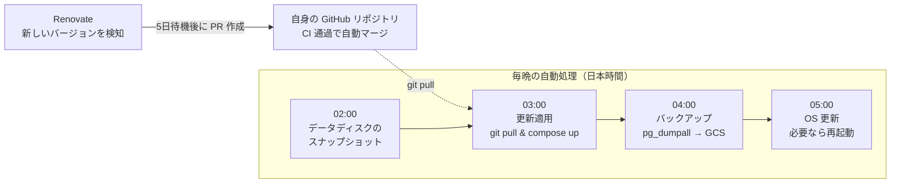

[English](README.md) | 日本語

# Windmill on GCE

このプロジェクトは、ワークフロー自動化ツール（iPaaS）である [Windmill](https://www.windmill.dev/) を、Google Cloud Platform（GCP）の Compute Engine（GCE）上で手軽にセルフホストし、長期間安全に運用し続けるためのデプロイ用テンプレートです。

- **手軽なデプロイ**: IaC ツールである Pulumi を利用。`pulumi up` を1回実行するだけで、VM、ファイアウォール、バックアップ用バケット、監視アラートなどの構築と初期セットアップが自動で行われます。
- **自動アップデート**: Renovate が Windmill や各コンポーネントの最新バージョンを検知し、PR を自動作成します。サプライチェーン攻撃対策として公開から5日間の待機期間を設け、CI を通過したマイナー・パッチ更新は自動マージされます。VM が毎晩 `main` ブランチを取り込むため、マージされた更新はその日の夜に反映されます。
- **確実なバックアップ**: 毎晩 `pg_dumpall` で PostgreSQL の全データベースをダンプし、GCS バケットへ転送します。また、更新処理の直前にはデータディスクのスナップショットを自動取得します。
- **ワークフローの Git 管理**: Windmill CLI を通じて、ワークフローをローカルリポジトリと同期できます。VS Code や AI コーディングエージェントを活用してワークフローを記述し、GitHub 上でバージョン管理が可能です。

## Windmill Cloud との違い

Windmill には、開発元が運用するマネージドサービス [Windmill Cloud](https://www.windmill.dev/pricing) も用意されています。

- **Windmill Cloud が適しているケース**: サーバー運用の手間をかけたくない、Enterprise Edition の高度な機能が必要
- **このテンプレートが適しているケース**: データを自身の GCP プロジェクト内に保持したい、運用コストを GCP のインフラ実費（VM・ディスク・バケット）のみに抑えたい

主な上限と料金の比較です（2026 年 11 月時点の [料金ページ](https://www.windmill.dev/pricing) より）。

| | 本テンプレート（Community Edition） | Cloud Free | Cloud Team |
|---|---|---|---|
| **月額コスト** | 約 16〜20ドル（GCP 実費、ユーザー数不問） | 0 ドル | 1 シート 10ドル（閲覧・実行のみの人は半シート） |
| **月間実行件数** | **無制限**（VM スペックの範囲内） | 1,000件 | 1 シートあたり 10,000件 |
| **ユーザー数** | 最大 50人（SSO ログインは最大 10人） | 無制限 | 最大 10 シート |
| **ワークスペース** | 最大 3つ | 無制限 | ワークスペースごとに契約 |

Cloud の実行件数は「1 秒未満のジョブ = 1 件」としてカウントされ、1 秒を超えるジョブは実行秒数分が加算されます。フローの件数は、各ステップの件数の合計です。例えば 5 分間隔で動くスケジュールが 1 本あるだけで月約 8,600 件、1 分間隔なら月約 43,000 件を消費します。本テンプレートの費用は Cloud Team の 2 シート分にあたるため、スクリプトやフローを作る人が 3 人以上いるか、月 2 万件を超えるなら、セルフホスト構成のほうが安くなります。

このテンプレートは更新やバックアップを自動化しますが、運用基盤はあくまで自身の GitHub リポジトリと GCP プロジェクトです。障害やアラートが発生した際は、自身で対応する必要があります。

### 費用の目安

既定の構成（`us-west1`、`e2-small`）の場合、月額コストの目安は **Caddy 構成で約 16〜19 ドル**、**Tunnel 構成で約 20 ドル** です（2026 年 11 月時点の Cloud Billing SKU 単価および検証環境の実測値に基づく）。

| 項目 | 月額（USD） | 備考 |
|---|---|---|
| **VM（e2-small）** | 12.23 | |
| **ディスク（ブート 10 GB + データ 20 GB、pd-balanced）** | 3.00 | |
| **外部 IP（Caddy 構成）** | 0〜3.65 | 請求アカウント全体で月 720 時間（VM 1 台分相当）までは無料枠（0 ドル） |
| **スナップショット（7 日分保持）** | 約 0.3 | 差分バックアップ。初回約 4 GB、以降 1 日あたり約 0.2 GB |
| **DB ダンプ（30 日分） / Pulumi ステート** | 実質 0 ドル | ダンプは 1 回あたり数百 KB 程度のため、ほぼかからない |
| **Cloud KMS 鍵** | 0.06 | |
| **Cloud NAT（Tunnel 構成）** | 約 4.7 | ゲートウェイ（1.02 ドル）+ NAT 用 IP（3.65 ドル）。NAT の IP には無料枠が適用されないため、Tunnel 構成の方がわずかに高くなります |

Cloud Logging および Cloud Monitoring は、VM 1 台分のログ・メトリクス量であれば通常は無料枠に収まります。東京（`asia-northeast1`）に置くと、同じ構成で月に 4 ドルほど高くなります。リージョンやマシンタイプを変更する場合は、[Google Cloud 料金計算ツール](https://cloud.google.com/products/calculator) で試算してください。

## 全体の構成

### VM の構成



ブートディスク（10 GB）には、OS など再生成可能なコンポーネントのみを配置しています。永続化が必要なデータはすべてデータディスク（`/mnt/data`）に集約されているため、VM 自体はいつでも安全に再作成できます。

### ネットワーク・外部公開方式

- **Caddy（デフォルト）**: Caddy が HTTPS 接続を直接受け付け、Let's Encrypt から SSL/TLS 証明書を自動取得します（Windmill 公式推奨の構成に準拠）。
- **Cloudflare Tunnel（より安全）**: Cloudflare Tunnel と Cloudflare Access を組み合わせることで、より安全に運用できます。Cloudflare 側で利用者を事前認証し、許可されたトラフィックのみを VM へ転送します。VM から Cloudflare へのアウトバウンド接続のみで通信するため、外部へ開放するインバウンドポートが不要（ゼロオープンポート）になります。
- **切り替え方法**: [手順 2](#2-設定ファイルの編集) の設定ファイルで、`exposure` を `caddy` から `tunnel` に変更するだけで切り替え可能です。初回デプロイの前に決めてください。

### 毎晩の更新の流れ



更新処理の直前に必ずスナップショットを取得するため、更新によって万が一不具合が発生した場合でも、直前の状態へすぐに復元できます。

### リポジトリのファイル構成

- `pulumi/`: インフラ構成をコードで管理する Pulumi プログラムです。VM、ディスク、ネットワーク、サービスアカウント、バケット、スナップショットポリシー、アラート等を作成します。初回デプロイ時やインフラ構成を変更する際に実行します。
- `configs/`: GCE VM 上で動作する設定ファイル群です。
  - `docker-compose.yml` / `Caddyfile` / `.env.example`: コンテナ構成および Web サーバー設定
  - `setup-vm.sh`: VM 起動時の初期セットアップ（`.env` の生成、cron の登録、コンテナ起動、管理者初期パスワードの設定）
  - `update.sh`: 毎晩の自動更新スクリプト
  - `backup.sh`: 毎晩のバックアップスクリプト
  - `healthcheck.sh`: 5分ごとの死活監視スクリプト
  - `set-env.sh`: `.env` の環境変数を安全に変更するスクリプト
- `workspace/`: ワークフローコードの配置用ディレクトリです（サンプルを1つ同梱）。`wmill sync` コマンドで Windmill と双方向同期します。VM 側ではこのディレクトリを使用しないため、必要に応じて別リポジトリに切り離しても問題ありません。
- `renovate.json`: 依存パッケージやコンテナイメージの自動更新方針を定義した設定ファイルです。
- `wmill.yaml`（直下）と `.claude/settings.json`: `wmill` の誤操作を防ぐ設定です。詳しくは「[ワークフローの同期](#ワークフローの同期)」を参照してください。

## デプロイ手順

### 前提条件・必要なもの

- 課金を有効にした GCP プロジェクト（以下、プロジェクト ID を `WMIL_PROJECT_ID` と表記）
- Cloudflare DNS、または任意の DNS 管理サービス
- 以下の CLI ツール:
  - `gcloud`
  - `pulumi`
  - `pnpm`

### 1. リポジトリの作成

1. GitHub 上で **Use this template** をクリックし、自身のリポジトリを作成します（Public / Private のどちらでも動作します）。
2. 作成したリポジトリに [Renovate GitHub App](https://github.com/apps/renovate) を導入します。初回にオンボーディング PR が作成されますが、本リポジトリにはすでに `renovate.json` が用意されているため、マージせずにクローズして構いません。
3. リポジトリをローカル環境にクローンします。

Fork ではなく Template を使う理由と、テンプレート元の改善を取り込む方法は、「[よくある質問](#よくある質問)」を参照してください。

### 2. 設定ファイルの編集

`pulumi/Pulumi.prod.yaml` 内の `__CHANGE_ME__` を自身の環境に合わせて書き換え、コミットします。このファイルにシークレット（機密情報）は含まれないため、リポジトリにコミットしても安全です。

| 項目 | 設定内容 |
|---|---|
| `gcp:project` | `WMIL_PROJECT_ID` |
| `gcp:region`、`gcp:zone` | VM を配置するリージョン・ゾーン（既定: `us-west1` / `us-west1-b`） |
| `windmill-gce:domain` | Windmill にアクセスするドメイン名（`https://` は含めない） |
| `windmill-gce:repoUrl` | 手順 1 で作成した GitHub リポジトリの URL（下記参照） |
| `windmill-gce:alertEmail`（任意） | アラート通知を受け取るメールアドレス。未設定の場合は通知メールが送信されません |
| `windmill-gce:exposure`（任意） | 公開方式。既定は `caddy`。Cloudflare Tunnel を使う場合は `config:` の下に `windmill-gce:exposure: tunnel` を追記し、先に「[Cloudflare Tunnel を利用する場合](#cloudflare-tunnel-を利用する場合)」を読んでください |

`repoUrl` には、VM が毎晩 `git pull` で最新設定を取得するための URL を指定します。

- **Public リポジトリの場合**: HTTPS 形式（`https://github.com/<owner>/<repo>.git`）
- **Private リポジトリの場合**: SSH 形式（`git@github.com:<owner>/<repo>.git`）。VM の初回起動時に Deploy Key が自動生成されるため、[手順 5](#5-初回ログインと初期設定) で GitHub に登録します。

### 3. GCP の初期セットアップ

```bash
# gcloud CLI にログインし、対象プロジェクトを設定
gcloud auth login --no-launch-browser --update-adc
export CLOUDSDK_CORE_PROJECT=WMIL_PROJECT_ID

# Pulumi のステート管理用 GCS バケットを作成
gcloud storage buckets create "gs://${CLOUDSDK_CORE_PROJECT}-pulumi-state" --location=us-west1 --uniform-bucket-level-access

# Pulumi のシークレット暗号化用 Cloud KMS キーを作成
gcloud services enable cloudkms.googleapis.com
gcloud kms keyrings create pulumi --location=global
gcloud kms keys create state --keyring=pulumi --location=global --purpose=encryption
```

以降のコマンドは `$CLOUDSDK_CORE_PROJECT` からプロジェクト ID を取るため、手順 4 のデプロイ完了まで同じシェルで続けてください。

### 4. デプロイの実行

```bash
cd pulumi
pnpm install
export PULUMI_BACKEND_URL="gs://${CLOUDSDK_CORE_PROJECT}-pulumi-state"
pulumi stack init prod --secrets-provider="gcpkms://projects/${CLOUDSDK_CORE_PROJECT}/locations/global/keyRings/pulumi/cryptoKeys/state"
pulumi up
```

`pulumi stack init` を実行すると、`Pulumi.prod.yaml` に暗号化キーの情報が2行追記されます。この変更も Git にコミットしてください。

Caddy 構成では、`pulumi up` の完了時に表示される `publicIp` を確認し、DNS サービスで A レコードを作成します。Tunnel 構成では `publicIp` は出力されず、DNS の設定も不要です。「[Cloudflare Tunnel を利用する場合](#cloudflare-tunnel-を利用する場合)」に進んでください。

- **レコード種別**: A
- **ホスト名**: `Pulumi.prod.yaml` に設定したドメイン
- **IP アドレス**: 出力された `publicIp` の値
- **プロキシ状態**: **OFF（DNS only）**

> [!IMPORTANT]
> Cloudflare を利用する場合、プロキシ（オレンジ色の雲アイコン）は必ず **OFF** にしてください（[理由をみる](#cloudflareなぜプロキシを-off-にするのか)）。Cloudflare を前に置きたい場合は、[Cloudflare Tunnel を利用する構成](#cloudflare-tunnel-を利用する場合)を選択してください。

DNS レコードの反映後、VM 上の Caddy が Let's Encrypt から証明書を自動取得し、`https://<ドメイン>` へアクセスできるようになります。

ログイン画面が開かない場合は、「[DNS を設定してもログイン画面が開かない](#caddydns-を設定してもログイン画面が開かない)」を参照してください。

### 5. 初回ログインと初期設定

> [!IMPORTANT]
> **Private リポジトリの場合**:
> VM の公開鍵を表示し、GitHub リポジトリの `Settings` → `Deploy keys` に登録してください（`Allow write access` のチェックは外してください）。VM は起動後1時間の間、30秒間隔でリポジトリの clone を再試行しているため、Deploy Key を登録すると自動的に処理が継続し、Windmill の起動まで進みます。
>
> ```bash
> # pulumi ディレクトリで実行
> $(pulumi stack output deployKeyCommand)
> ```

`pulumi up` 完了後、VM 上で Docker のセットアップやコンテナの起動が行われるまで5分ほどかかります。起動完了後、以下のコマンドで管理者の初期パスワードを取得します。

```bash
# pulumi ディレクトリで実行
# 管理者の初期パスワードを取得
$(pulumi stack output sshCommand) -- sudo cat /mnt/data/config/admin-password
```

ブラウザで `https://<ドメイン>` を開き、ログインします。

- **メールアドレス**: `admin@windmill.dev`
- **パスワード**: 先ほど取得した初期パスワード

ログイン後、セキュリティのため **`Instance settings` → `Users`** から自身用の Superadmin アカウントを新規作成し、初期ユーザーである `admin@windmill.dev` は無効化（Disable）してください。

### Cloudflare Tunnel を利用する場合

1. [手順 2](#2-設定ファイルの編集) で `windmill-gce:exposure: tunnel` を設定してから、`pulumi up` を実行します。VM にパブリック IP は付与されず、Cloud NAT を経由してアウトバウンド通信のみを行います（パブリック DNS の A レコード登録は不要です）。
2. Cloudflare Zero Trust 管理画面の `Networks` → `Tunnels` でトンネルを新規作成し、パブリックホスト名を設定します。
   - **ホスト名**: `Pulumi.prod.yaml` に記載したドメイン
   - **サービス**: `http://windmill_server:8000`

   ※ 画面上に表示される `docker run` コマンドは実行しないでください（VM 上の Docker Compose が cloudflared を自動起動します）。
3. 画面に表示されたトンネルトークンを VM の `.env` に設定します。以下のコマンドを実行すると対話形式で安全にトークンが書き込まれ、`setup-vm.sh` が自動実行されて cloudflared が起動します。
   ```bash
   # pulumi ディレクトリで実行
   $(pulumi stack output sshCommand) -- -t sudo /opt/windmill/configs/set-env.sh CLOUDFLARE_TUNNEL_TOKEN
   ```
4. 必要に応じて Cloudflare Access アプリケーションを設定し、特定のドメインやメールアドレスを持つユーザーのみにアクセスを制限します。

> [!WARNING]
> 外部サービスからの Webhook 等を受け取る HTTP トリガーは `/api/r/` 以下のパスで処理されます。サイト全体に Cloudflare Access の認証を適用すると、外部サービスからの Webhook もブロックされてしまいます。`/api/r/*` のパスに対しては Bypass ポリシーを設定した別個の Access アプリケーションを作成し、ワークフローのスクリプト内でリクエスト署名等を検証する構成にしてください。

## ワークフローの同期

`workspace/` 内のスクリプトやフローを、Windmill CLI（`wmill`）を使って Windmill インスタンスと同期します。

### 初回の設定

1. `workspace/wmill.yaml` の `baseUrl` にある `__CHANGE_ME__` を、自身のドメイン（`https://<ドメイン>/`）に書き換えます。
2. CLI ツールをインストールし、接続プロファイルを登録します。プロファイル名は `wmill.yaml` の設定に合わせて `windmill-gce` を指定します。

```bash
# Windmill CLI のインストール
pnpm install -g windmill-cli

# プロファイルの登録（トークン入力またはブラウザ認証が求められます）
# ※ 新しいインスタンスに最初からあるのは管理用の admins だけです。ワークフロー用のワークスペースを作り、その ID を指定します
wmill workspace add windmill-gce <ワークスペースID> https://<ドメイン>/

# ワークスペースディレクトリに移動し、初期同期（リモートから取得）を実行
cd workspace
wmill sync pull
```

### 開発・同期の流れ

`wmill sync` は Git のような3者マージ（差分統合）を行わず、**同期元の内容で同期先をそのまま上書き（完全同期）** します。

| コマンド | 同期方向 | 上書き・消失のリスク |
|---|---|---|
| `wmill sync pull` | Windmill → ローカル | ローカルの未コミットの変更が上書きされます |
| `wmill sync push` | ローカル → Windmill | Windmill 画面上で直接加えた変更や、ローカルに存在しないリソースが削除されます |

そのため、日常の開発は以下の手順で進めてください。

1. **最新状態の取得**: 編集前に `wmill sync pull` を実行（※ローカルに未コミットの変更がある場合は先にコミットまたは退避してください）。
2. **ベースラインの記録**: 取得した最新状態を Git にコミット（万が一のロールバック地点を確保）。
3. **ローカルで編集**: VS Code や AI コーディングエージェント等でスクリプトやフローを開発・修正。
4. **差分確認とプッシュ**: `--yes` を付けずに `wmill sync push` を実行。表示される差分一覧（作成・更新・削除されるリソース）を目視確認した上で適用を承認。
5. **Git へのコミット**: 確定した変更を Git にコミットしてプッシュ。

> [!WARNING]
> `wmill sync push` は、`wmill.yaml` の `includes` に一致し、ローカルに存在しないリソースを Windmill から削除します。`includes` は Git で管理するフォルダーのみに絞ってください。また、**リポジトリ直下では `wmill` を実行しないでください**（[理由をみる](#wmillai-エージェントや誤操作にはどう備えているのか)）。

## 日常の運用

### スケジュール処理一覧

VM 上では以下の定期タスクが自動実行されます（VM の内部時刻は UTC です）。

| 実行時刻（UTC / 日本時間） | 処理内容 | 実行スクリプト・コンポーネント |
|---|---|---|
| 毎日 17:00 / 02:00 | データディスクのスナップショット取得 | `pulumi/snapshot.ts`（GCP スケジュール） |
| 毎日 18:00 / 03:00 | `git pull` およびコンテナイメージの更新 | `configs/update.sh` |
| 毎日 19:00 / 04:00 | PostgreSQL 全データベースのダンプ（GCS へ転送） | `configs/backup.sh` |
| 毎日 20:00 / 05:00 | OS パッケージのセキュリティ更新（必要に応じて再起動） | `unattended-upgrades` |
| 5分ごと | サービスの死活監視（ヘルスチェック） | `configs/healthcheck.sh` |

### 自動アップデートとマージのポリシー

Renovate は更新の提案や承認待ちのアップデートを、リポジトリの Issue「Dependency Dashboard」に集約します。

| アップデート種別 | 更新挙動 |
|---|---|
| **Windmill / Caddy / cloudflared**（マイナー・パッチ） | CI 通過後に自動マージ。同日深夜に VM へ自動反映 |
| **Pulumi パッケージ** | CI 通過後に自動マージ。次回の `pulumi up` 実行時に反映 |
| **PostgreSQL**（マイナーアップデート） | Dependency Dashboard で承認後、自動マージ（年数回） |
| **PostgreSQL 以外のメジャーアップデート** | Dependency Dashboard で承認すると PR が作成され、手動マージ |
| **PostgreSQL のメジャーアップデート** | Dependency Dashboard に表示のみ。**マージしない**（下記参照） |

PostgreSQL のメジャーバージョンは手作業で上げます（[理由をみる](#postgresqlなぜメジャーバージョンは自動で上げないのか)）。[Windmill 公式ガイド](https://www.windmill.dev/docs/advanced/self_host#upgrade-postgresql-to-18) の手順に従ってください。

> [!CAUTION]
> PostgreSQL のメジャーバージョンアップ PR をそのままマージしないでください。PostgreSQL 18 以降はメジャーバージョンごとに別のデータディレクトリを使うため、新バージョンは旧バージョンのデータを見つけられず、空のデータベースを新規作成して起動してしまいます。誤った起動を防ぐため、VM 上のチェックスクリプト（`configs/check-pg-major.sh`）がデータとバージョンの不一致を検知した場合、起動および夜間更新を直ちに停止してアラートを発報します。

### VM スペック・ディスク容量の変更

`pulumi` ディレクトリで設定値を変更し、`pulumi up` を再実行します。

例えば、メモリや CPU を増強するためにマシンタイプを変更する場合:

```bash
pulumi config set windmill-gce:machineType e2-medium
pulumi up
```

VM が停止し、新しいマシンタイプで自動再起動します。OS イメージの変更など VM 自体を再作成するような変更であっても、永続化データはすべて独立したデータディスクに保持されており、VM 起動時に自動セットアップされるため手作業のデータ移行は不要です。

データディスクの容量拡張も同様の手順で行えます（ディスク拡張時は VM の停止すら不要です）。

```bash
pulumi config set windmill-gce:dataDiskGb 30
pulumi up
```

これで広がるのはディスクだけで、その上のファイルシステムは元の大きさのままです。VM は次の起動時に自動で追いつきます。すぐに使いたい場合は、マウントしたまま次のコマンドで広げます。

```bash
$(pulumi stack output sshCommand) -- sudo resize2fs /dev/disk/by-id/google-windmill-data
```

`appName` を変えている場合は、デバイス名の `windmill` の部分を読み替えてください。

### 環境変数（.env）の変更

`.env` の環境変数（`WINDMILL_DOMAIN` や `COMPOSE_PROFILES` など）が Pulumi から渡されるのは VM の初回作成時のみです。運用開始後に値を変更する場合は `set-env.sh` を使用します。値を更新後、`setup-vm.sh` を実行してコンテナへ反映させます。なお、ドメインを変更する場合は `Pulumi.prod.yaml` の `domain` 設定も合わせて変更してください。

```bash
# pulumi ディレクトリで実行
# 通常の環境変数を更新する場合
$(pulumi stack output sshCommand) -- sudo /opt/windmill/configs/set-env.sh WINDMILL_DOMAIN new.example.com

# 機密情報は引数に含めず、対話入力で安全に設定する
$(pulumi stack output sshCommand) -- -t sudo /opt/windmill/configs/set-env.sh CLOUDFLARE_TUNNEL_TOKEN
```

## 障害時の復旧

復旧手段には以下の 3 つがあります。スナップショットとバックアップはデータベース全体を復元するため、**スナップショットやダンプの取得時点より後に行われた変更は、すべてのワークスペースで失われます**。

| 障害・復旧のシナリオ | 使用する手段 | 理由・特徴 |
|---|---|---|
| **特定のスクリプトやフローを前の版に戻したい** | Git の履歴 | 該当ファイルのみをロールバックして `wmill sync push` すれば、他のデータに一切影響を与えずに復元可能（[ワークフローの同期](#ワークフローの同期)） |
| **夜間更新の直後に起動不能・異常動作が発生した** | [スナップショット](#スナップショットからの復元) | 更新直前の状態へ迅速・確実にロールバック可能（ダウンタイムは約 20 秒、7 日分保持） |
| **データディスクや VM 自体を喪失した / 別プロジェクトへ移行したい** | [バックアップ](#バックアップからのリストア) | ダンプファイルはディスクから独立した GCS バケットに隔離保管されており、VM からの誤削除不可（30 日分保持） |
| **8 日以上前の過去の状態に戻したい** | [バックアップ](#バックアップからのリストア) | スナップショットの保持期限（7 日間）を超過しているため |

### スナップショットからの復元

夜間アップデート等で障害が発生した場合は、更新直前に取得されたスナップショットから PostgreSQL のデータのみを書き戻します。

ディスクごとは差し替えず、スナップショットから作った一時ディスクからデータだけを書き戻します（[理由をみる](#スナップショットなぜディスクごと戻さないのか)）。Windmill が止まるのは、書き戻しの約 20 秒です。

1. **原因となった更新の取り消し**: Renovate がマージしたコミットをローカルで `git revert` してリモートに push します（取り消さない場合、次の夜に同じ更新が再適用されてしまいます）。
2. **一時ディスクの作成と VM へのアタッチ**（ローカルの `pulumi/` ディレクトリで実行）:

   ```bash
   # 使用するスナップショットを確認（更新直前、日本時間 02:00 に取得されたもの）
   gcloud compute snapshots list --sort-by=~creationTimestamp

   # スナップショットから一時ディスクを作成し、VM に読み取り専用でアタッチ
   gcloud compute disks create windmill-restore --zone $(pulumi stack output instanceZone) --source-snapshot <スナップショット名> --type pd-balanced
   gcloud compute instances attach-disk $(pulumi stack output instanceName) --zone $(pulumi stack output instanceZone) --disk windmill-restore --device-name windmill-restore --mode ro
   ```

3. **PostgreSQL データの書き戻し**（VM 内で実行）: 以下のコマンドを 1 行ずつ実行します。

   ```bash
   cd /opt/windmill/configs
   sudo mkdir -p /mnt/restore

   # 読み取り専用ディスクのため、ジャーナル再生（書き込み）をスキップする noload オプションを指定してマウント
   sudo mount -o ro,noload /dev/disk/by-id/google-windmill-restore /mnt/restore

   # コンテナを停止し、障害データを念のため退避
   sudo docker compose stop
   sudo mv /mnt/data/postgres /mnt/data/postgres.broken

   # スナップショットから正常なデータをコピー
   sudo cp -a /mnt/restore/postgres /mnt/data/postgres

   # 手順 1 の revert を取り込み、ロールバック前のバージョンでコンテナを起動
   sudo ./update.sh

   # 一時ディスクをアンマウント
   sudo umount /mnt/restore && sudo rmdir /mnt/restore
   ```

   ※ 起動時に PostgreSQL のログに `database system was not properly shut down; automatic recovery in progress` と出力されますが、正常な動作です（稼働中に取得したスナップショットのため、起動時に自動リカバリが実行されます）。

4. **動作確認と後片付け**: ブラウザから Windmill が正常に開けることを確認した後、一時リソースを削除します。

   ```bash
   # VM 上で退避データを削除
   sudo rm -rf /mnt/data/postgres.broken

   # ローカルの pulumi/ ディレクトリで一時ディスクをデタッチ＆削除
   gcloud compute instances detach-disk $(pulumi stack output instanceName) --zone $(pulumi stack output instanceZone) --disk windmill-restore
   gcloud compute disks delete windmill-restore --zone $(pulumi stack output instanceZone)
   ```

### バックアップからのリストア

GCS バケットに保存されたダンプファイルから、空のデータベースへデータを復元する手順です。

```bash
# VM 内（SSH 接続後）で実行
cd /opt/windmill/configs
# .env からバケット名を読み出す（.env は root しか読めないため sudo で）
BACKUP_BUCKET="$(sudo sed -n 's/^BACKUP_BUCKET=//p' .env)"

# 保存されているバックアップファイル一覧を確認
gcloud storage ls "gs://$BACKUP_BUCKET/db/"

# コンテナを停止し、データベースディレクトリを退避
sudo docker compose stop windmill_server windmill_worker windmill_worker_native
sudo docker compose down db && sudo mv /mnt/data/postgres /mnt/data/postgres.old
sudo docker compose up -d --wait db

# 対象のダンプファイルをリストア（YYYYMMDDTHHMMSSZ 部分を取得したい日時に置き換え）
gcloud storage cat "gs://$BACKUP_BUCKET/db/windmill-YYYYMMDDTHHMMSSZ.sql.gz" | gunzip \
  | sudo docker compose exec -T db psql -U windmill -d postgres

# ダンプファイルには取得時点の DB パスワードが含まれるため、現在の .env の設定値に合わせ直します。
# データディスクの再作成時や別 VM へのリストア時など、.env がダンプより新しい場合にこの設定を行わないと
# Windmill からデータベースへの接続に失敗します。
sudo docker compose exec -T db sh -c 'echo "ALTER ROLE :\"u\" PASSWORD :'"'"'pw'"'"';" \
  | psql -q -U "$POSTGRES_USER" -d postgres -v u="$POSTGRES_USER" -v pw="$POSTGRES_PASSWORD"'

# ダンプファイルにはクエリ実行計画用の統計情報が含まれていないため、手動で再生成します。
# これを怠ると、PostgreSQL の autovacuum が追いつくまでクエリ性能が大幅に低下します。
sudo docker compose exec -T db sh -c 'vacuumdb -U "$POSTGRES_USER" --all --analyze-in-stages'

sudo docker compose up -d
```

- リストア実行時に `windmill` ロールやデータベースについて「already exists」というエラーが出力されますが、コンテナ起動時に事前作成されたものであるため無視して問題ありません。
- Windmill で PostgreSQL トリガー（CDC/レプリケーション）を利用している場合は、リストア後に各トリガーを保存・再有効化してください（`pg_dumpall` のダンプにはレプリケーションスロットが含まれません）。

※ 詳細な仕様や注意事項については [Windmill 公式のバックアップ＆リストア手順](https://www.windmill.dev/docs/advanced/self_host#back-up-and-restore) もあわせて参照してください。

## こんなときは

### うまくいかないとき

#### Cloud KMS：`keyrings create` が「API が有効になっていない」と返す

Cloud KMS API を有効化した直後は、反映まで数分かかることがあります。少し待ってから再実行してください。

#### Caddy：DNS を設定してもログイン画面が開かない

Caddy を再起動してください。DNS の反映前に Caddy が証明書の取得を試みて失敗すると、しばらく待ってから再試行するためです。Let's Encrypt のレートリミットにかかると、1 時間ほど待つこともあります。

```bash
# pulumi ディレクトリで実行
$(pulumi stack output sshCommand) -- 'cd /opt/windmill/configs && sudo docker compose restart caddy'
```

#### VM：`pulumi up` から 5 分以上たっても Windmill が起動しない

VM の起動ログ（シリアルポートの出力）で、どこで止まっているかを確認します。Private のリポジトリなら、Deploy Key の登録待ちで止まっていることが多いです（[手順 5](#5-初回ログインと初期設定)）。

```bash
# pulumi ディレクトリで実行
gcloud compute instances get-serial-port-output $(pulumi stack output instanceName) --zone $(pulumi stack output instanceZone)
```

#### wmill：`sync push` で必要なファイルが Windmill から消えた

ローカルで消したファイルが、push で Windmill からも消えた場合です。Git にコミット済みなら、`git checkout HEAD -- f/` でファイルを復元し、再度 `wmill sync push` を実行してください。

### よくある質問

#### Pulumi：Pulumi Cloud のアカウントは要る？

要りません。Pulumi のステートファイルは、手順 3 で作る GCS バケットに保存します。

#### GitHub：なぜ Fork ではなく Template を使うのか

Fork は元リポジトリと同じ公開範囲（Public）に固定され、Private にできないためです。その代わり、テンプレート元の改善は自動では届きません（Renovate が届けるのは、イメージやパッケージの更新だけです）。

#### GitHub：テンプレート元の改善を取り込むには

Template から作ったリポジトリは、テンプレート元とコミット履歴が繋がっていません。取り込みたいコミットを `cherry-pick` します。

```bash
git remote add upstream https://github.com/cojiso/windmill-gce.git
git fetch upstream
git log upstream/main          # 取り込みたいコミットを確認
git cherry-pick <コミットハッシュ>
```

#### GitHub：Public のリポジトリで運用しても大丈夫？

大丈夫です。データベースのパスワードなどのシークレットは、リポジトリではなく、VM のデータディスク上の `.env` にだけ保存されます。

#### gcloud・Pulumi：なぜ環境変数でプロジェクトを指定するのか

`gcloud config set project` や `pulumi login` は、手元のすべてのプロジェクトに効くグローバルな設定を変えてしまいます。環境変数なら、ほかの GCP や Pulumi のプロジェクトに影響しません。毎回 `export` するのが手間なら、`CLOUDSDK_CORE_PROJECT` と `PULUMI_BACKEND_URL` を `mise.local.toml`（mise）や `.envrc`（direnv）に書いておきます。どちらも `.gitignore` に入っています。

#### Pulumi：なぜパスフレーズではなく Cloud KMS を使うのか

Pulumi は、ステート内のシークレットを暗号化するために、パスフレーズか鍵を必要とします。Cloud KMS の鍵は `gcloud` の認証で自動的に使われるため、パスフレーズを管理する必要も、コマンドのたびに入力する必要もありません。Compute Engine などの残りの API は、Pulumi が自動で有効化します。

#### GCP：なぜ既定のリージョンは us-west1 なのか

同じ VM でも、東京（`asia-northeast1`）より安いためです（差額は[費用の目安](#費用の目安)を参照）。レイテンシが気になる場合は、手順 2 で変更してください。

#### Cloudflare：なぜプロキシを OFF にするのか

ON にすると、Cloudflare 側で TLS を終端してから VM に繋ぎ直すため、Caddy と証明書の処理が二重になり、暗号化モードの設定によってはリダイレクトループに陥ります。また、VM の公開 IP は開いたままなので、Cloudflare を迂回した直接のアクセスも防げません。

#### Renovate：CI は何を確かめているのか

Docker Compose ファイルの妥当性と、すべてのイメージタグが存在することです。新しい Windmill で既存のワークフローが動くかまでは確かめられません。そのため、毎晩の更新の直前にスナップショットを取得しています。

#### PostgreSQL：なぜメジャーバージョンは自動で上げないのか

イメージのタグを書き換えるだけでは上がらず、全データベースのダンプとリストアが必要なためです。メジャーバージョンは年に 1 回リリースされ、それぞれ 5 年間サポートされるので、急ぐ必要はありません。

#### スナップショット：なぜディスクごと戻さないのか

データディスクは Pulumi が管理しています。`gcloud` や GCP コンソールでディスクを差し替えると、次の `pulumi up` が構成のずれとして検知し、元のディスクに戻そうとします。

#### wmill：AI エージェントや誤操作には、どう備えているのか

- リポジトリ直下には、どのファイルにも一致しない `wmill.yaml` を置いています。直下で `wmill sync push` を実行しても、削除の対象が 0 件になります。
- Claude Code 向けに、`.claude/settings.json` の権限設定と hook（`.claude/hooks/guard-wmill.sh`）で、`wmill init`、`--yes` 付きの実行、パイプでの答えの流し込みを禁止しています。hook はコマンドの文字列全体を調べるため、`bash -c` やコマンドの連結で包んでもすり抜けません。
- `--yes` がなければ、`wmill sync push` は変更の一覧を表示して確認を求め、答えがない限り何も反映しません。エージェントが実行しても、確認のところで止まります。
- `workspace/AGENTS.md` に、同期の手順をエージェント向けに書いています。

## 対象外・制限事項

- **メールトリガー（ポート 25）**: Windmill 公式のフル構成ではメール受信トリガーのために Layer 4 対応の Caddy モジュールが使われていますが、このテンプレートでは対応していません。
- **Enterprise Edition（EE）**: このテンプレートは Community Edition（CE）を前提としています。Enterprise Edition を利用する場合は、Compose ファイル内のイメージを `windmill-ee` に変更し、インスタンス設定画面からライセンスキーを適用してください。

## ライセンス

[MIT](LICENSE)
