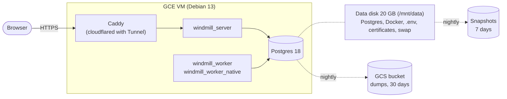
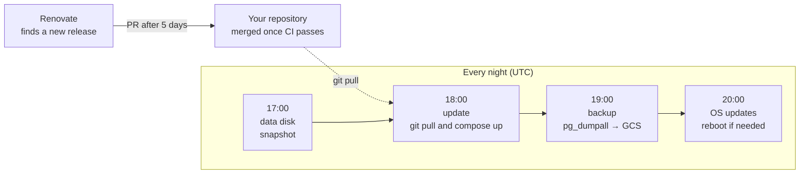

English | [日本語](README.ja.md)

# Windmill on GCE

This template lets you self-host [Windmill](https://www.windmill.dev/), the workflow automation platform, on Google Cloud's Compute Engine (GCE) with little effort, and keep it running safely for a long time.

- **Easy deploy**: with Pulumi, a tool that manages infrastructure as code, one `pulumi up` creates and sets up the virtual machine (VM), firewall, backup bucket, alerts and the rest.
- **Automatic updates**: Renovate, a bot that watches for updates, turns new versions of Windmill and the rest into PRs. It waits 5 days after a release, as a guard against supply-chain attacks, and merges minor and patch updates once CI passes. The VM pulls `main` every night, so a merged update is live the same night.
- **Backups**: every night `pg_dumpall` dumps every Postgres database to a GCS bucket. Before every update, the data disk is snapshotted.
- **Workflows in GitHub**: Windmill's CLI syncs workflows with the repository, so you can write them in VS Code or with a coding agent and keep them on GitHub.

## Compared with Windmill Cloud

Windmill also runs [Windmill Cloud](https://www.windmill.dev/pricing), operated by its developers.

- **Windmill Cloud suits you** if you'd rather not spend time running a server, or need Enterprise Edition features.
- **This template suits you** if you want your data in your own GCP project, or want to pay only the GCP bill (VM, disks, bucket).

The main limits and prices, from the [pricing page](https://www.windmill.dev/pricing) in November 2026:

| | This template (Community Edition) | Cloud Free | Cloud Team |
|---|---|---|---|
| **Monthly cost** | 16 to 20 USD (GCP bill, whatever the headcount) | 0 USD | 10 USD a seat (a user who only runs or views counts as half a seat) |
| **Executions / month** | **Unlimited** (as far as VM resources allow) | 1,000 | 10,000 per seat |
| **Users** | Up to 50 (up to 10 via SSO) | Unlimited | Up to 10 seats |
| **Workspaces** | Up to 3 | Unlimited | Billed per workspace |

On Cloud, one execution is one job under a second; a longer job counts once per second. A flow counts the sum of its steps. For example, a schedule running every 5 minutes consumes about 8,600 executions a month, and every minute consumes about 43,000. This template costs about as much as two Team seats, so self-hosting is cheaper once three or more people build scripts or flows, or once you pass 20,000 executions a month.

This template automates updates and backups, but the machinery lives in your repository and your GCP project. When an alert comes in, you deal with it.

### What it costs

With the default configuration (`us-west1`, `e2-small`), monthly costs are about **16 to 19 USD with Caddy**, and about **20 USD with Tunnel** (based on Cloud Billing SKU prices in November 2026 and measured usage on a test environment).

| Item | USD a month | Note |
|---|---|---|
| **VM (e2-small)** | 12.23 | |
| **Disks (boot 10 GB + data 20 GB, pd-balanced)** | 3.00 | |
| **External IP (Caddy)** | 0 to 3.65 | The first 720 hours a month (one VM equivalent) are free across the billing account |
| **Snapshots (7 days retained)** | about 0.3 | Incremental backup: about 4 GB initially, then ~0.2 GB per day |
| **Backup dumps (30 days) / Pulumi state** | ~0 USD | Dumps are a few hundred KB each, so they cost next to nothing |
| **Cloud KMS key** | 0.06 | |
| **Cloud NAT (Tunnel)** | about 4.7 | Gateway (1.02) plus NAT IP (3.65). Unlike external IPs, NAT IPs have no free tier, so Tunnel is slightly more expensive |

Cloud Logging and Cloud Monitoring usually stay within the free tier for one VM. In Tokyo (`asia-northeast1`), the same setup costs about 4 dollars a month more. For another region or machine type, check with the [pricing calculator](https://cloud.google.com/products/calculator).

## How it fits together

### Inside the VM



The boot disk (10 GB) holds only what can be rebuilt, such as the OS. Everything worth keeping is on the data disk, so the VM can be rebuilt at any time.

### The front door

- By default, Caddy takes HTTPS connections and gets the certificate itself, as in Windmill's official setup.
- For more security, use Cloudflare Tunnel with Cloudflare Access. Cloudflare authenticates people before GCP, and only passes authorized requests on to the VM. The VM only connects out to Cloudflare, so no port is open to the internet.
- To switch, change `exposure` from `caddy` to `tunnel` in the settings file in [step 2](#2-fill-in-the-settings). Decide before the first deploy.

### The nightly update



The snapshot always comes first, so a bad update can be undone back to the state just before it.

### What is in the repository

- `pulumi/`: the Pulumi program. It creates the VM, disks, network, service account, bucket, snapshots and alerts. Run it the first time, and again when you change the infrastructure itself.
- `configs/`: what runs on the VM. The main files are below; the rest are helpers they call.
  - `docker-compose.yml`, `Caddyfile`, `.env.example`: the containers
  - `setup-vm.sh`: setup on every boot. Creates `.env`, installs cron, starts the containers, replaces the admin password
  - `update.sh`: the nightly update
  - `backup.sh`: the nightly backup
  - `healthcheck.sh`: the health check every 5 minutes
  - `set-env.sh`: changing a value in `.env`
- `workspace/`: where your workflows live. It holds one sample. `wmill sync` syncs it with Windmill. The VM does not use it, so it can move to a repository of its own.
- `renovate.json`: what gets updated, and how.
- `wmill.yaml` (at the root) and `.claude/settings.json`: guards against `wmill` mistakes. See [Syncing workflows](#syncing-workflows).

## Deploy

### What you need

- A GCP project with billing enabled (its project ID is written `MY_PROJECT_ID` below)
- Cloudflare DNS, or any other DNS service
- These CLI tools: `gcloud`, `pulumi`, `pnpm`

### 1. Make your repository

1. On GitHub, press **Use this template** to make your own repository. Public and private both work.
2. Install the [Renovate GitHub app](https://github.com/apps/renovate) on it. Renovate first opens an onboarding PR; `renovate.json` is already there, so close it.
3. Clone it.

Why a template rather than a fork, and how to take in template improvements: see the [FAQ](#faq).

### 2. Fill in the settings

Replace the `__CHANGE_ME__` values in `pulumi/Pulumi.prod.yaml` and commit it. Nothing in it is secret.

| Key | Value |
|---|---|
| `gcp:project` | `MY_PROJECT_ID` |
| `gcp:region`, `gcp:zone` | Where the VM runs. `us-west1` by default |
| `windmill-gce:domain` | The host name Windmill is served on, without `https://` |
| `windmill-gce:repoUrl` | The repository from step 1. See below |
| `windmill-gce:alertEmail` (optional) | Email address for alerts. Without it, alerts notify nobody |
| `windmill-gce:exposure` (optional) | The front door. `caddy` by default. For Cloudflare Tunnel, add `windmill-gce:exposure: tunnel` under `config:`, and read [Using Cloudflare Tunnel](#using-cloudflare-tunnel) first |

`repoUrl` is what the VM pulls every night.

- **Public repository**: the HTTPS URL (`https://github.com/you/windmill-gce.git`)
- **Private repository**: the SSH URL (`git@github.com:you/windmill-gce.git`). The VM makes a deploy key on first boot, which you add on GitHub in step 5.

### 3. Prepare GCP

```bash
# Log in to the CLI and pick the project
gcloud auth login --no-launch-browser --update-adc
export CLOUDSDK_CORE_PROJECT=MY_PROJECT_ID

# A bucket for Pulumi's state
gcloud storage buckets create "gs://${CLOUDSDK_CORE_PROJECT}-pulumi-state" --location=us-west1 --uniform-bucket-level-access

# A key Pulumi encrypts secrets with
gcloud services enable cloudkms.googleapis.com
gcloud kms keyrings create pulumi --location=global
gcloud kms keys create state --keyring=pulumi --location=global --purpose=encryption
```

The commands after it take the project ID from `$CLOUDSDK_CORE_PROJECT`, so stay in the same shell through step 4.

### 4. Deploy

```bash
cd pulumi
pnpm install
export PULUMI_BACKEND_URL="gs://${CLOUDSDK_CORE_PROJECT}-pulumi-state"
pulumi stack init prod --secrets-provider="gcpkms://projects/${CLOUDSDK_CORE_PROJECT}/locations/global/keyRings/pulumi/cryptoKeys/state"
pulumi up
```

`pulumi stack init` adds two lines about the key to `Pulumi.prod.yaml`. Commit them too.

With Caddy, when `pulumi up` prints `publicIp`, create the DNS record below. With Tunnel there is no `publicIp` and no DNS record to create; go on to [Using Cloudflare Tunnel](#using-cloudflare-tunnel).

- Type: A
- Name: the domain in `Pulumi.prod.yaml`
- IP: the `publicIp` value
- Proxy: off

> [!IMPORTANT]
> Keep Cloudflare's proxy off ([see why](#cloudflare-why-keep-the-proxy-off)). If you want Cloudflare in front, use the [Cloudflare Tunnel setup](#using-cloudflare-tunnel).

Caddy on the VM then gets a certificate from Let's Encrypt by itself, and `https://<your domain>` opens.

If the login page does not open, see [The login page does not open after the DNS record is set](#caddy-the-login-page-does-not-open-after-the-dns-record-is-set).

### 5. First login

> [!IMPORTANT]
> **Private repository**: print the VM's public key and add it under `Settings › Deploy keys` on GitHub, with write access off. The VM retries the clone every 30 seconds for an hour, so once the key is there, it goes on to start Windmill.
>
> ```bash
> # Run from the pulumi directory
> $(pulumi stack output deployKeyCommand)
> ```

After `pulumi up`, the VM takes about 5 minutes to install Docker and start Windmill. Then get the initial admin password:

```bash
# Run from the pulumi directory
# The initial admin password
$(pulumi stack output sshCommand) -- sudo cat /mnt/data/config/admin-password
```

Open `https://<your domain>` and log in:

- Account: `admin@windmill.dev`
- Password: the initial admin password from above

Then, in `Instance settings › Users`, create a superadmin account for yourself and disable `admin@windmill.dev`.

### Using Cloudflare Tunnel

1. Set `windmill-gce:exposure: tunnel` in [step 2](#2-fill-in-the-settings) before running `pulumi up`. The VM gets no public IP and reaches the internet through Cloud NAT.
2. In `Cloudflare Zero Trust › Networks › Tunnels`, create a tunnel and add a public hostname:
   - Hostname: the domain in `Pulumi.prod.yaml`
   - Service: `http://windmill_server:8000`

   Don't run the `docker run` command Cloudflare shows; compose starts cloudflared.
3. Put the tunnel token shown there into `.env` on the VM. The token is read without being shown; then `setup-vm.sh` runs and starts cloudflared.
   ```bash
   # Run from the pulumi directory
   $(pulumi stack output sshCommand) -- -t sudo /opt/windmill/configs/set-env.sh CLOUDFLARE_TUNNEL_TOKEN
   ```
4. Create a Cloudflare Access application to limit who can open Windmill to people with an email address on your own domain.

> [!WARNING]
> HTTP triggers (webhooks), through which outside services call Windmill, live under `/api/r/`. Putting Access in front of everything blocks them. Create a second application for that path with a Bypass policy, and verify the signature inside the workflow script.

## Syncing workflows

The workflows in `workspace/` sync with Windmill through the Windmill CLI (`wmill`).

### First-time setup

1. In `workspace/wmill.yaml`, replace `__CHANGE_ME__` in `baseUrl` with your domain.
2. Install the CLI and add a profile. Name it `windmill-gce` to match `wmill.yaml`. It asks for a token or a browser login.

```bash
npm install -g windmill-cli
# A new instance only has the admins workspace, meant for administration. Create a workspace for your workflows and use its ID
wmill workspace add windmill-gce <workspace id> https://<your domain>/
cd workspace
wmill sync pull
```

### Editing

`wmill sync` does not merge like git: it overwrites one side with the other.

| Command | Direction | What can be lost |
|---|---|---|
| `wmill sync pull` | Windmill → local | Uncommitted local changes |
| `wmill sync push` | local → Windmill | Changes made in the Windmill UI, and anything missing locally |

So work in this order:

1. `wmill sync pull` to take in the latest from Windmill (commit uncommitted changes first)
2. Commit the state before editing, as a point to go back to
3. Edit in VS Code or with a coding agent
4. `wmill sync push` without `--yes`, and read the changes before confirming
5. Commit and push to git

> [!WARNING]
> `wmill sync push` deletes from Windmill whatever matches `includes` in `wmill.yaml` but is missing locally. Keep `includes` to the folders you keep in git. And don't run `wmill` at the repository root ([see why](#wmill-what-guards-against-agents-and-mistakes)).

## Day to day

What runs on a schedule. The VM's clock is in UTC.

| When (UTC) | What happens | Run by |
|---|---|---|
| Daily 17:00 | Data disk snapshot | `pulumi/snapshot.ts` |
| Daily 18:00 | `git pull` and image updates | `configs/update.sh` |
| Daily 19:00 | `pg_dumpall` to the bucket | `configs/backup.sh` |
| Daily 20:00 | OS updates (reboot if needed) | `unattended-upgrades` |
| Every 5 minutes | Health check | `configs/healthcheck.sh` |

### Which updates merge by themselves

Renovate collects the updates that wait for approval in an issue in your repository, the Dependency Dashboard.

| Update | What happens |
|---|---|
| Windmill, Caddy, cloudflared minor and patch | Merged once CI passes; live on the VM that night |
| Pulumi packages | Merged once CI passes; takes effect at your next `pulumi up` |
| Postgres minor | Merged by itself once approved on the Dependency Dashboard (a few times a year) |
| Majors other than Postgres | Approving on the Dependency Dashboard opens a PR; merge it by hand |
| Postgres major | Only listed on the Dependency Dashboard. **Don't merge it** (see below) |

Postgres majors are upgraded by hand ([see why](#postgresql-why-are-majors-not-upgraded-automatically)). Follow [Windmill's guide](https://www.windmill.dev/docs/advanced/self_host#upgrade-postgresql-to-18).

> [!CAUTION]
> Don't merge a Postgres major PR as it is. From 18 on, each major keeps its data in its own directory, so the new version does not find the old data: it creates a new, empty database and starts on that. To prevent it, the VM stops setup and the nightly update, and alerts you, when the data and the version don't match (`configs/check-pg-major.sh`).

### Changing the VM

Change a setting in the `pulumi` directory and run `pulumi up`.

For more memory, for example, change the machine type:

```bash
pulumi config set windmill-gce:machineType e2-medium
pulumi up
```

The VM stops and starts again with the new machine type. Even a change that rebuilds the VM, such as another image, needs nothing by hand: the new VM sets itself up from the data disk.

The data disk can grow the same way, without stopping anything:

```bash
pulumi config set windmill-gce:dataDiskGb 30
pulumi up
```

This grows the disk, not the file system on it. The VM catches up at its next boot; to use the space now, grow it while it is mounted:

```bash
$(pulumi stack output sshCommand) -- sudo resize2fs /dev/disk/by-id/google-windmill-data
```

With a different `appName`, replace `windmill` in the device name.

### Changing `.env`

The values in `.env` (`WINDMILL_DOMAIN`, `COMPOSE_PROFILES` and so on) come from Pulumi on the first boot only. To change one later, use `set-env.sh`. It writes the value, then runs `setup-vm.sh` to apply it. When you change the domain, change `domain` in `Pulumi.prod.yaml` to match.

```bash
# Run from the pulumi directory
# A value that is not secret
$(pulumi stack output sshCommand) -- sudo /opt/windmill/configs/set-env.sh WINDMILL_DOMAIN new.example.com
# A secret: type it instead of passing it as an argument
$(pulumi stack output sshCommand) -- -t sudo /opt/windmill/configs/set-env.sh CLOUDFLARE_TUNNEL_TOKEN
```

## Recovery

There are three recovery options. A snapshot or a backup restores the entire database, so **any changes made after that point are lost across all workspaces**.

| Scenario | Recommended method | Why |
|---|---|---|
| **Restore a single script or flow to an earlier version** | Git history | Restore just that file and run `wmill sync push`; no other workspaces or data are affected ([Syncing workflows](#syncing-workflows)) |
| **Windmill fails to start or behaves abnormally after a nightly update** | [Snapshot](#restoring-a-snapshot) | Fast and accurate rollback to the state just before the update (~20 seconds downtime, 7 days retained) |
| **Data disk or VM is lost, or migrating to another project** | [Backup](#restoring-a-backup) | Dumps are stored in an isolated GCS bucket separate from the disk, and the VM cannot delete them (30 days retained) |
| **Restore data older than 7 days** | [Backup](#restoring-a-backup) | Snapshot retention period (7 days) has expired |

### Restoring a snapshot

When a nightly update causes an issue, restore the PostgreSQL data from the snapshot taken immediately before the update.

The disk is not swapped as a whole; only the data is copied back from a temporary disk made from the snapshot ([see why](#snapshots-why-not-restore-the-whole-disk)). Windmill is down only for the 20 seconds or so of the copy.

1. **Revert the update**: Run `git revert` on the commit merged by Renovate and push to remote. (Otherwise, the same update will be re-applied the next night.)
2. **Create an ephemeral disk from the snapshot and attach it read-only** (run from the local `pulumi/` directory):

   ```bash
   # Identify the snapshot taken just before the update (17:00 UTC)
   gcloud compute snapshots list --sort-by=~creationTimestamp

   # Create and attach the disk
   gcloud compute disks create windmill-restore --zone $(pulumi stack output instanceZone) --source-snapshot <snapshot name> --type pd-balanced
   gcloud compute instances attach-disk $(pulumi stack output instanceName) --zone $(pulumi stack output instanceZone) --disk windmill-restore --device-name windmill-restore --mode ro
   ```

3. **Restore PostgreSQL data on the VM** (run on the VM): Run the commands one line at a time.

   ```bash
   cd /opt/windmill/configs
   sudo mkdir -p /mnt/restore

   # Mount with noload to skip journal replay (which requires write access) on the read-only disk
   sudo mount -o ro,noload /dev/disk/by-id/google-windmill-restore /mnt/restore

   # Stop containers and back up broken data
   sudo docker compose stop
   sudo mv /mnt/data/postgres /mnt/data/postgres.broken

   # Copy healthy data from snapshot
   sudo cp -a /mnt/restore/postgres /mnt/data/postgres

   # Apply the revert from step 1 and start on the previous version
   sudo ./update.sh

   # Unmount the restore disk
   sudo umount /mnt/restore && sudo rmdir /mnt/restore
   ```

   ※ Postgres logs `database system was not properly shut down; automatic recovery in progress`. This is normal behavior for online snapshots; automatic crash recovery runs on startup.

4. **Verify and clean up**: Once you verify Windmill opens cleanly in your browser, clean up the temporary resources.

   ```bash
   # On the VM: delete the broken data backup
   sudo rm -rf /mnt/data/postgres.broken

   # From the local pulumi/ directory: detach and delete the temporary disk
   gcloud compute instances detach-disk $(pulumi stack output instanceName) --zone $(pulumi stack output instanceZone) --disk windmill-restore
   gcloud compute disks delete windmill-restore --zone $(pulumi stack output instanceZone)
   ```

### Restoring a backup

How to restore a dump from the bucket into an empty database:

```bash
# Run on the VM (via SSH)
cd /opt/windmill/configs
# Read the bucket name from .env (only root can read it, hence sudo)
BACKUP_BUCKET="$(sudo sed -n 's/^BACKUP_BUCKET=//p' .env)"

# Inspect available backups in the bucket
gcloud storage ls "gs://$BACKUP_BUCKET/db/"

# Stop services and move the existing database aside
sudo docker compose stop windmill_server windmill_worker windmill_worker_native
sudo docker compose down db && sudo mv /mnt/data/postgres /mnt/data/postgres.old
sudo docker compose up -d --wait db

# Restore the target dump (replace YYYYMMDDTHHMMSSZ with the timestamp you want)
gcloud storage cat "gs://$BACKUP_BUCKET/db/windmill-YYYYMMDDTHHMMSSZ.sql.gz" | gunzip \
  | sudo docker compose exec -T db psql -U windmill -d postgres

# The dump also restores the database password it was taken with. Set it back to the one in .env,
# or Windmill cannot connect to the database when .env is newer than the dump (a rebuilt data disk, another VM).
sudo docker compose exec -T db sh -c 'echo "ALTER ROLE :\"u\" PASSWORD :'"'"'pw'"'"';" \
  | psql -q -U "$POSTGRES_USER" -d postgres -v u="$POSTGRES_USER" -v pw="$POSTGRES_PASSWORD"'

# A dump carries no planner statistics; without them queries are slow until autovacuum catches up.
sudo docker compose exec -T db sh -c 'vacuumdb -U "$POSTGRES_USER" --all --analyze-in-stages'

sudo docker compose up -d
```

- Errors saying the `windmill` role and database "already exist" are fine. The new container made them before the restore.
- If you use Postgres triggers in Windmill, save and re-enable each one. The dump does not carry the replication slots they use.

This follows [Windmill's official restore steps](https://www.windmill.dev/docs/advanced/self_host#back-up-and-restore).

## FAQ

### When something goes wrong

#### Cloud KMS: `keyrings create` says the API is not enabled

A newly enabled API takes a few minutes to work. Wait a little and run it again.

#### Caddy: The login page does not open after the DNS record is set

Restart Caddy. When Caddy fails to get the certificate before DNS is ready, it waits a while before trying again. If you hit Let's Encrypt's limit on failed attempts, that can take an hour.

```bash
# Run from the pulumi directory
$(pulumi stack output sshCommand) -- 'cd /opt/windmill/configs && sudo docker compose restart caddy'
```

#### VM: Windmill has not started 5 minutes after `pulumi up`

Read the VM's boot log (the serial port output) to see where it stopped. With a private repository, it is usually waiting for the deploy key ([step 5](#5-first-login)).

```bash
# Run from the pulumi directory
gcloud compute instances get-serial-port-output $(pulumi stack output instanceName) --zone $(pulumi stack output instanceZone)
```

#### wmill: `sync push` removed a file I needed from Windmill

That happens when the file was deleted locally. If it was committed to git, restore it with `git checkout HEAD -- f/` and run `wmill sync push` again.

### Questions

#### Pulumi: Do I need a Pulumi Cloud account?

No. Pulumi keeps its state file in the GCS bucket made in step 3.

#### GitHub: Why a template rather than a fork?

A fork has the same visibility as the original and cannot be made private. The trade-off: improvements to this template do not reach you by themselves (Renovate only brings new versions of images and packages).

#### GitHub: How do I take in template improvements?

A repository made from a template shares no history with the original, so cherry-pick the changes you want, commit by commit:

```bash
git remote add upstream https://github.com/cojiso/windmill-gce.git
git fetch upstream
git log upstream/main          # find the commits you want
git cherry-pick <commit>
```

#### GitHub: Is a public repository safe?

Yes. Secrets such as the database password live in `.env` on the VM's data disk, never in the repository.

#### gcloud and Pulumi: Why pick the project with environment variables?

`gcloud config set project` and `pulumi login` change global settings that apply to all your projects. Environment variables leave your other GCP and Pulumi projects alone. To skip the `export`s in each new shell, put `CLOUDSDK_CORE_PROJECT` and `PULUMI_BACKEND_URL` in `mise.local.toml` (mise) or `.envrc` (direnv); both files are in `.gitignore`.

#### Pulumi: Why Cloud KMS rather than a passphrase?

Pulumi needs a passphrase or a key to encrypt the secrets in its state file. Your gcloud login uses the KMS key automatically, so there is no passphrase to remember or type on every command. Pulumi enables the other APIs, such as Compute Engine, itself.

#### GCP: Why is us-west1 the default region?

The same VM costs less than in Tokyo (`asia-northeast1`); see [What it costs](#what-it-costs). If latency matters, change it in step 2.

#### Cloudflare: Why keep the proxy off?

With it on, Cloudflare terminates TLS with its own certificate and connects to the VM again, so there are two certificates, and with some Cloudflare encryption modes the page redirects forever. The VM's public IP also stays open, so anyone can go around Cloudflare.

#### Renovate: What does CI check?

That the compose file is valid and that every image tag exists. It cannot check that a new Windmill actually works with your workflows, which is why a snapshot is taken before every nightly update.

#### PostgreSQL: Why are majors not upgraded automatically?

Changing the tag is not enough: every database has to be dumped and restored. A major comes once a year and is supported for 5 years, so there is no hurry.

#### Snapshots: Why not restore the whole disk?

Pulumi manages the data disk. Swap it with gcloud or the console, and the next `pulumi up` sees the change as drift and tries to put the old disk back.

#### wmill: What guards against agents and mistakes?

- The `wmill.yaml` at the repository root matches no file, so `wmill sync push` run there has nothing to delete.
- For Claude Code, the permission rules in `.claude/settings.json` and a hook (`.claude/hooks/guard-wmill.sh`) forbid `wmill init`, any `--yes`, and piping an answer into `wmill`. The hook reads the whole command string, so wrapping it in `bash -c` or a chain does not get past it.
- Without `--yes`, `wmill sync push` lists the changes and asks before applying them, and applies nothing without an answer. Run by an agent, it stops at that question.
- `workspace/AGENTS.md` gives agents the syncing steps.

## Not covered

- Email triggers (port 25): the official setup uses a layer-4 build of Caddy for them.
- Enterprise Edition: this template runs the Community Edition. For the Enterprise Edition, change the image to `windmill-ee` and add your license key in the instance settings.

## License

[MIT](LICENSE)
